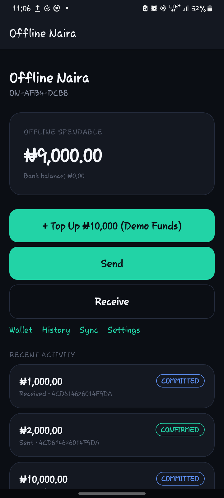
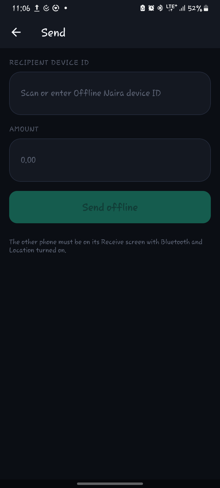
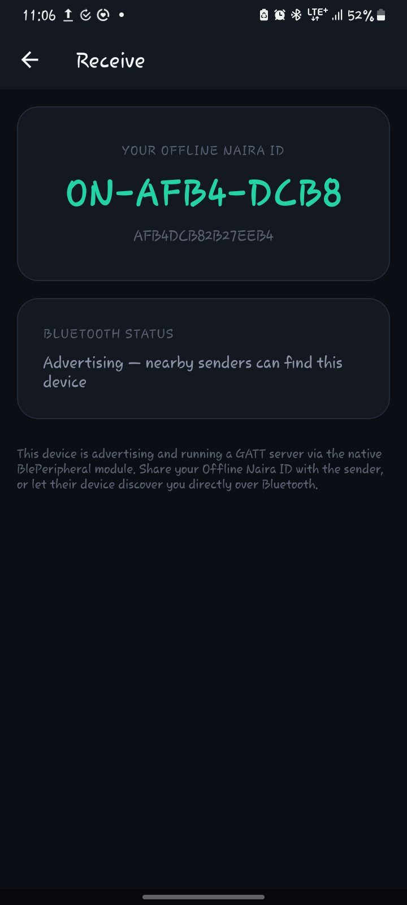
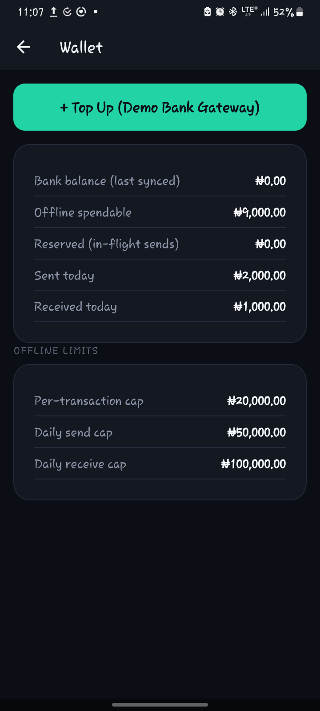

OfflineNaira 🇳🇬📱

An offline-first mobile payment prototype exploring peer-to-peer transaction exchange over Bluetooth Low Energy (BLE).

OfflineNaira explores how mobile devices can exchange transaction data in environments where internet connectivity is unreliable or unavailable.

The project was developed as a hackathon prototype to investigate an alternative communication approach for digital payments in low-connectivity environments.

«Project status: Hackathon prototype. Bank integration and real-world transaction settlement are not implemented. Some native Bluetooth functionality still requires compilation and physical-device testing.»

---

💡 The Problem

Unstable internet connectivity and network outages can interrupt digital payment activities, particularly in areas with unreliable network coverage.

OfflineNaira explores an alternative by allowing nearby devices to communicate through Bluetooth Low Energy (BLE), exchange transaction data, and maintain locally stored transaction records for subsequent synchronisation.

The goal is to investigate how offline communication could help reduce dependence on continuous internet connectivity for certain payment workflows.

---

🛠️ Technologies and Architecture

The application combines a cross-platform mobile development framework with native Android functionality.

Technology| Purpose
React Native| Mobile application interface and application logic
TypeScript| Main application programming language
Expo| Mobile development environment and native integration
Kotlin| Custom Android BLE peripheral module
React Native BLE PLX| Bluetooth Low Energy central functionality
SQLite / expo-sqlite| Local data persistence
Expo SecureStore| Secure storage of device identity material
TweetNaCl| Cryptographic operations
Jest| Automated testing
Git| Version control

Architecture overview

- Mobile application layer: Handles the user interface, application state, wallet screens and transaction workflows.
- Bluetooth communication layer: Uses React Native BLE PLX for central functionality and a custom Kotlin Android module for BLE peripheral functionality.
- Communication protocol: TypeScript handles message framing, chunking and reassembly for Bluetooth data exchange.
- Data layer: SQLite stores local application data, including transaction-related records.
- Validation and security: Includes transaction validation, device identity and cryptographic functionality.

---

✨ Key Features

- Offline-first transaction workflows: Supports locally managed transaction records and pending transactions without requiring an active internet connection for every operation.
- Bluetooth Low Energy communication: Implements device discovery, connection and transaction-data exchange functionality.
- Transaction validation: Includes validation mechanisms such as transaction expiry and nonce checks.
- Local data persistence: Uses SQLite to maintain application and transaction-related records.
- Wallet interface: Provides screens for wallet information, sending, receiving and transaction history.
- Bank top-up simulation: Includes a mock banking interface for demonstrating top-up workflows.
- Automated tests: Includes Jest tests covering money calculations, transaction validation, authentication and transaction state transitions.

---

 📸 Application Screenshots

| Main Dashboard | Send Interface |
| :---: | :---: |
|  |  |

| Receive & BLE Status | Wallet & Offline Limits |
| :---: | :---: |
|  |  |

⚠️ Limitations and Future Improvements

OfflineNaira is a prototype and has not been validated as a production financial application.

Current limitations and areas for improvement include:

- Bank integration: The current bank gateway is simulated. Real banking infrastructure and transaction settlement need to be implemented.
- Native Bluetooth testing: The custom Kotlin BLE peripheral module requires compilation and testing on physical Android devices.
- Device compatibility: BLE behaviour, advertising limitations and background restrictions may vary across Android devices.
- Transaction synchronisation: More advanced conflict-resolution and reconciliation mechanisms are needed when multiple devices operate offline.
- Security validation: Cryptographic functionality is present, but the complete application requires security review and testing before real financial use.
- Scalability: A reliable backend and reconciliation infrastructure would be needed for deployment to a larger user base.

---

🚀 Getting Started

Prerequisites

Before running the application, ensure you have:

- Node.js and npm installed.
- Java Development Kit (JDK) configured.
- Android Studio and Android SDK configured.
- A physical Android device with Bluetooth support and USB debugging enabled.
- Expo development build tooling.

Note: The custom BLE peripheral functionality requires native Android integration. An ordinary Expo Go session is not sufficient to test the complete application.

Installation

1. Clone the repository

Replace the URL below with the actual repository URL:

git clone https://github.com/Crizdan/offlinenaira.git

2. Navigate into the project directory

cd offlinenaira

3. Install dependencies

npm install

4. Generate the native Android project

npx expo prebuild

5. Build and run on an Android device

npx expo run:android

Refer to "modules/ble-peripheral/README.md" for additional instructions concerning the custom native Bluetooth module. Its implementation still requires compilation and physical-device testing.

---

🧪 Running Tests

Run the automated test suite:

npm test

Check TypeScript types:

npm run typecheck

---

🤝 Contributing

Contributions, suggestions and technical feedback are welcome.

If you are interested in improving offline communication, mobile application development or Bluetooth-based transaction workflows, feel free to explore the project and share your ideas.

---

⚖️ Disclaimer

OfflineNaira is an educational and experimental hackathon project. It is not a licensed financial service, does not provide real bank transactions, and should not be used to transfer actual funds.

Built through experimentation, collaboration, debugging and continuous learning.